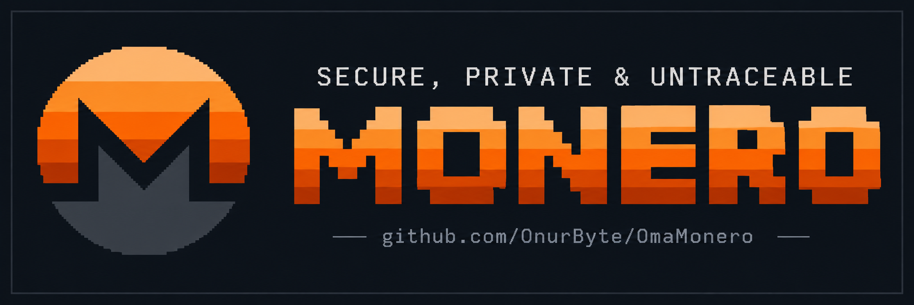
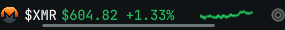
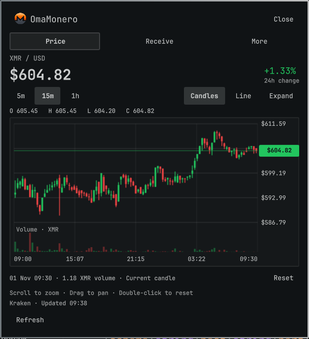
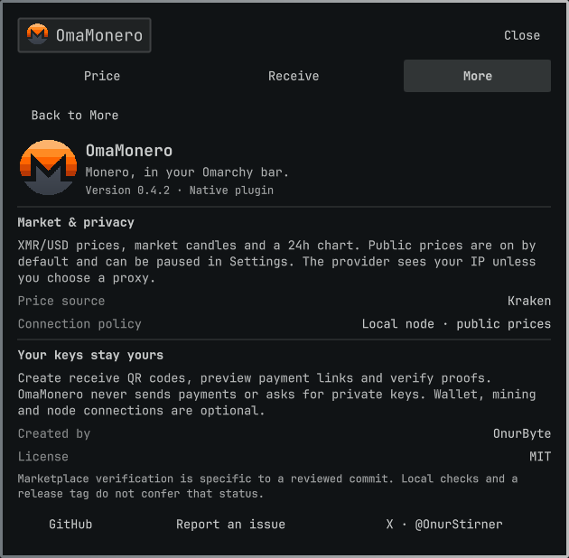

# OmaMonero

  

  
  

XMR/USD prices, an advanced market chart and local payment tools in your existing Omarchy bar. No separate OmaMonero backend, service or user build step.

## Monero, at a glance

  

Your price stays in the bar. Open it for real candlesticks, XMR volume and a closer look at the market—without leaving your desktop.

  

Scroll to zoom, drag through history, or switch to a line chart. Price comes first; receiving and optional local tools are one tab away.

  

Actual Omarchy 0.4.2 captures, 1 November 2026. Market values change; the panel shows their source and update time. Original banner and Monero artwork retained.

## Install and use

Open the official Omarchy plugin manager, add `https://github.com/OnurByte/OmaMonero.git`, and enable OmaMonero. Open the XMR widget in your existing bar. All settings, diagnostics, payments and removal stay in this panel.

Monero RPC defaults to numeric loopback. XMR/USD prices and the 24-hour chart are enabled by default, as explicitly requested. You can pause public prices in Settings. Choose local, HTTPS direct, Tor or I2P policy there. Tor/I2P uses a local SOCKS5h proxy with remote DNS and never falls back to direct access. Wallet and miner RPC always remain on numeric loopback.

Price source and freshness are shown with the chart. Stale, invalid or unavailable data is explicit. The widget does not start a Monero node, Tor, I2P, wallet RPC or miner for you.

## Features

- XMR/USD sparkline and trailing 24-hour change, enabled by default.
- Native candle/line chart with real Kraken OHLC and XMR volume, 5m/15m/1h intervals, crosshair inspection, pointer/keyboard zoom, bounded history panning and an expanded view. Custom close-only sources use a line chart.
- A simple Price / Receive / More hierarchy; technical settings stay under Advanced.
- Monero node synchronization, peers, network, latency and storage information.
- Local watch-only wallet balance and latest 20 incoming transfers from a bounded 720-block window. Atomic amounts retain all 12 decimal places.
- Local XMRig API and P2Pool `local/stratum` data API telemetry.
- Offline public-address validation (Monero block Base58 and Keccak checksum), receive QR, payment-link preview and local wallet RPC transaction-proof verification.
- Optional `monero:` integration with a private, bounded session inbox. Requests never send payments. Wallet opening is explicit and receives no payment URI as a launch argument.
- Native settings, read-only diagnostics and removal through the official plugin manager.

Monitoring and notifications run while Quickshell is active. No separate OmaMonero daemon runs after the shell closes. Watch-only is a user confirmation; balances may overstate spendable funds without imported key images. Seed phrases and private spend keys are never requested.

The obsolete v0.3.2 standalone bundle is retired: private payment requests could appear in process listings. Do not use it.

Version 0.4.3 removes the retired configuration migration and service cleanup paths. All authored application logic, build scripts and presentation tests are TypeScript; the single committed JS file is generated for Quickshell.

## Settings

The panel uses `~/.config/omamonero/config.json`. Existing JSON settings, including paused prices and proxy choices, are retained. The retired TOML configuration and companion service are no longer read or managed. Settings can be changed directly in the native panel.

Optional payment-link integration restores and verifies the previous URI handler before removing owned files. If restoration fails, removal stops and keeps its receipt for retry.

## Compatibility and verification

Requires Omarchy Quattro / Quickshell and the standard desktop utilities shipped by Omarchy, including curl >=8.4, bash, coreutils, flock and xdg-mime. curl is a short-lived HTTP transport, not an OmaMonero backend. The optional wallet buttons require Feather or Monero GUI to be installed separately.

Local tests and checksums do not mean official marketplace verification. Marketplace review and removal of any Manual setup label are controlled by its maintainers; no approval is claimed here.

Development and test instructions: [docs/development.md](docs/development.md). Architecture: [docs/architecture.md](docs/architecture.md). Verification: [docs/verification.md](docs/verification.md).
